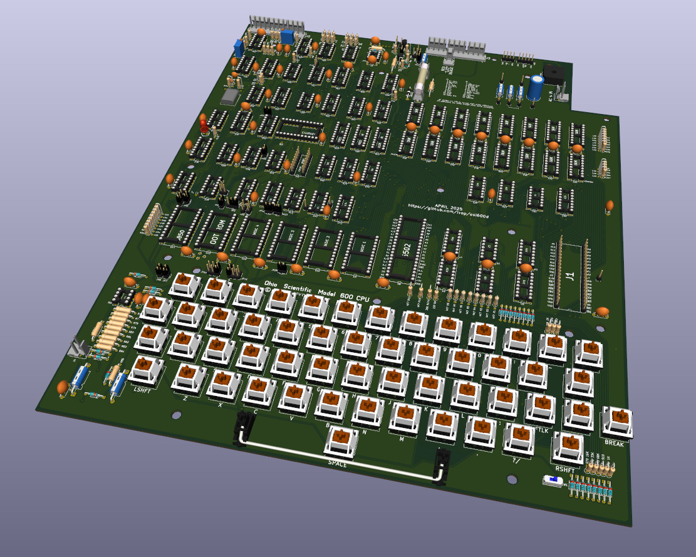

# Ohio Scientific 600D Remake

### Remake of the Ohio Scientific 600D PCB

* The new [schematics](doc/osi600d-schematic.pdf) are based on the original schematics, but with all [errors](doc/errors.txt) fixed.
* The PCB is mostly identical to the original, but with added silkscreen, and jumpers instead of trace cuts.
* In theory, you can build it solely with the [BOM](doc/osi600d-bom.pdf) and the new silkscreen, but the original Assembly Instructions still apply 100%.
* PCB uses Cherry MX key switches.
* 4-pin or 5-pin headers for USB-C or Micro USB breakout boards for power supply (e.g. Raspberry Pi 3A PS).
